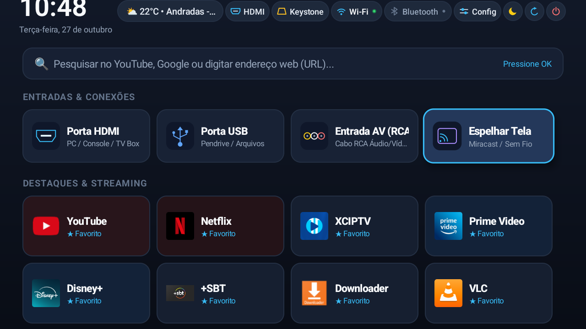
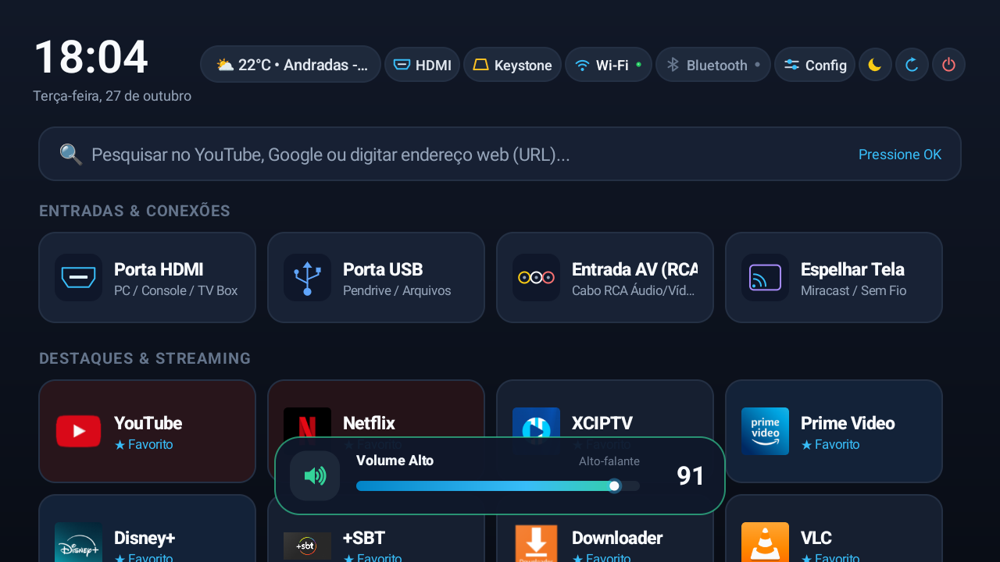
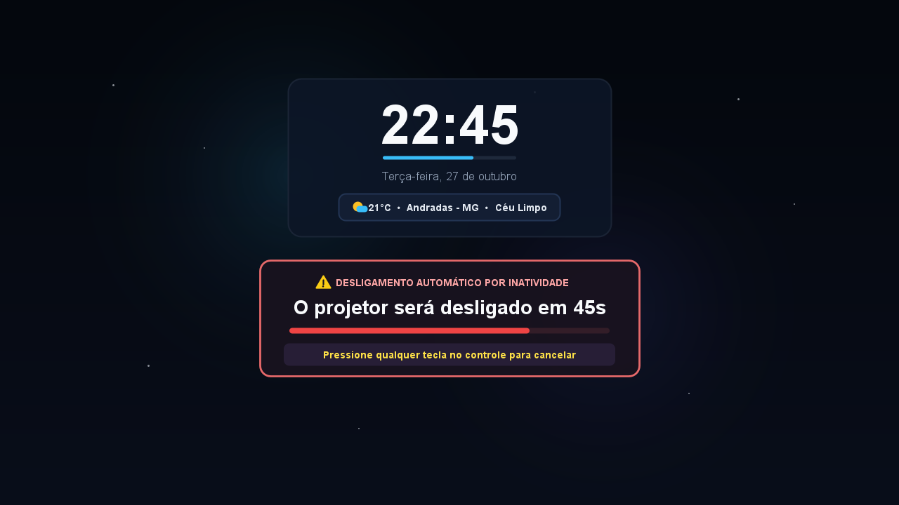
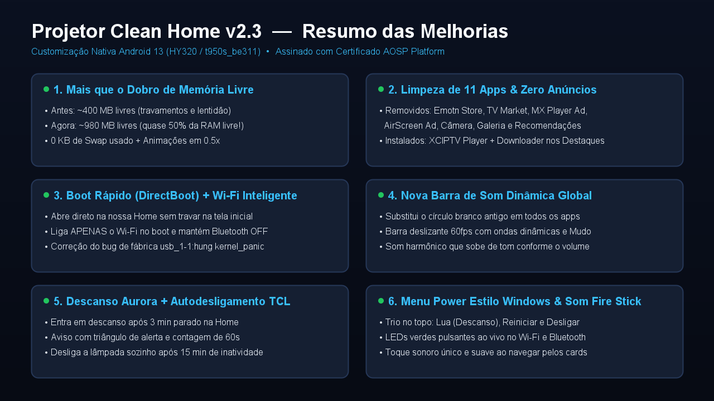

# 🎬 Launcher Projetor HY320 (`v2.3`)

**Launcher Nativo, Tela de Descanso Aurora e Barra de Som Dinâmica para Projetores Android 13 (HY320 / `t950s_be311` / Amlogic / Allwinner)**

Um sistema de tela inicial (**Home Launcher**), protetor de tela (**DreamService**) e **Barra de Volume Global** desenvolvido do zero em Java puro para substituir o sistema pesado e cheio de anúncios de fábrica dos projetores inteligentes Android.

* **Tamanho total do APK:** `~53 KB` (Zero bibliotecas pesadas, 100% código nativo e gráficos vetoriais via `Canvas`)
* **Consumo de Memória:** Mais que dobrou a memória RAM livre do projetor (de `~400 MB` para **`~980 MB livres`** com `0 KB` de Swap usado)
* **Zero Anúncios / Zero Telemetria**

---

## 📸 Capturas de Tela Reais

### 1. Tela Inicial (`MainActivity`)
Relógio, Data, Clima ao vivo (Open-Meteo, sem chaves de API), atalhos de hardware (**HDMI, Keystone, Wi-Fi e Bluetooth com LEDs animados de status ao vivo**), **Menu Power estilo Windows** (Descanso, Reiniciar e Desligar), Entradas Físicas (**Porta HDMI, Porta USB, Entrada AV RCA e Espelhar Tela Miracast**) e **Destaques & Streaming**.



---

### 2. Nova Barra de Som Dinâmica Global (`VolumeOverlayService`)
Substitui o círculo branco gigante antigo de fábrica (`com.droidlogic/.tvvolume.VolumeService`) em **todos os aplicativos** (Home, YouTube, Netflix, XCIPTV, Prime Video, HDMI). Conta com animação a 60fps, ondas sonoras dinâmicas, detecção automática de **Alto-falante / Bluetooth Áudio** e **som cristalino que muda de tom** conforme o volume sobe ou desce.



---

### 3. Tela de Descanso Aurora + Autodesligamento Estilo TVs TCL (`ScreensaverView`)
Entra automaticamente após **3 minutos** de inatividade para proteger o painel LCD do projetor (*anti-burn-in* flutuante). Ao completar **14 minutos** sem uso, exibe o card de aviso com triângulo vetorial `⚠️` e **contagem regressiva de 60 segundos** para apertar qualquer tecla ou desligar o projetor sozinho aos 15 minutos.



---

### 4. Resumo de Desempenho e Melhorias



---

## ⚡ Comparativo: Antes vs. Depois

| Métrica / Recurso | Sistema Original de Fábrica | Projector Clean Home `v2.3` |
| :--- | :--- | :--- |
| **Memória RAM Livre** | `~400 MB` livres | **`~980 MB` livres** (quase 50% de 2 GB!) |
| **Uso de Swap (Disco)** | Alto (causando travamentos) | **`0 KB` (Zero Swap)** |
| **Tamanho do Launcher** | `> 25 MB` + serviços em 2º plano | **`53 KB`** |
| **Inicialização (Boot)** | Lenta na tela *"Smart Projector"* | **Instantânea (`DirectBootAware`)** |
| **Wi-Fi vs. Bluetooth no Boot** | Desligava ou ligava tudo junto | **Liga só o Wi-Fi / Mantém Bluetooth OFF** |
| **Bug `usb_1-1:hung kernel_panic`** | Desligava o projetor sozinho | **Corrigido (`wifi_sleep_policy = 2`)** |
| **Barra de Volume** | Círculo branco gigante no meio da tela | **Barra flutuante 60fps com som dinâmico** |
| **Som de Navegação** | Duplicado / sem personalidade | **Toque único suave estilo Fire TV Stick** |

---

## 🚀 Como Instalar via ADB (Wi-Fi)

1. Ative a **Depuração ADB** no seu projetor e descubra o IP local dele no Wi-Fi (ex: `192.168.0.100`).
2. Instale o APK pronto [`android-launcher/ProjectorCleanHome.apk`](android-launcher/ProjectorCleanHome.apk) e defina como Launcher padrão:

```powershell
adb connect SEU_IP_AQUI:5555
adb -s SEU_IP_AQUI:5555 install -r android-launcher/ProjectorCleanHome.apk
adb -s SEU_IP_AQUI:5555 shell cmd package set-home-activity com.gabriel.projectorhome/.MainActivity
adb -s SEU_IP_AQUI:5555 shell settings put secure screensaver_components com.gabriel.projectorhome/com.gabriel.projectorhome.ProjectorDreamService
adb -s SEU_IP_AQUI:5555 shell appops set com.gabriel.projectorhome SYSTEM_ALERT_WINDOW allow
adb -s SEU_IP_AQUI:5555 shell pm disable com.droidlogic/.tvvolume.VolumeService
```

Ou, para compilar o código-fonte e instalar automaticamente com **1 comando** no PowerShell:

```powershell
powershell.exe -ExecutionPolicy Bypass -File .\compilar_e_instalar.ps1 -Ip "SEU_IP_AQUI"
```

---

## 📁 Estrutura do Código-Fonte

* [`android-launcher/src/com/gabriel/projectorhome/MainActivity.java`](android-launcher/src/com/gabriel/projectorhome/MainActivity.java) — Tela Inicial completa, ícones vetoriais `Canvas`, LEDs de status Wi-Fi/Bluetooth, integração nativa HDMI/AV (`TvContract`), som `SoundPool` e menu Power.
* [`android-launcher/src/com/gabriel/projectorhome/VolumeOverlayService.java`](android-launcher/src/com/gabriel/projectorhome/VolumeOverlayService.java) — Serviço global da Barra de Som Dinâmica a 60fps com síntese de áudio harmônico e progressão de tom (`pitch`).
* [`android-launcher/src/com/gabriel/projectorhome/ScreensaverView.java`](android-launcher/src/com/gabriel/projectorhome/ScreensaverView.java) — Protetor de tela Aurora + relógio/clima flutuante + card de desligamento automático por inatividade estilo TVs TCL.
* [`android-launcher/src/com/gabriel/projectorhome/BootReceiver.java`](android-launcher/src/com/gabriel/projectorhome/BootReceiver.java) — Inicialização `DirectBootAware` que ativa apenas o Wi-Fi, mantém o Bluetooth desligado e inicia o serviço da barra de volume.
* [`android-launcher/AndroidManifest.xml`](android-launcher/AndroidManifest.xml) — Manifesto configurado com `directBootAware="true"`, permissões de sistema e filtros de Home/Screensaver/Volume.
